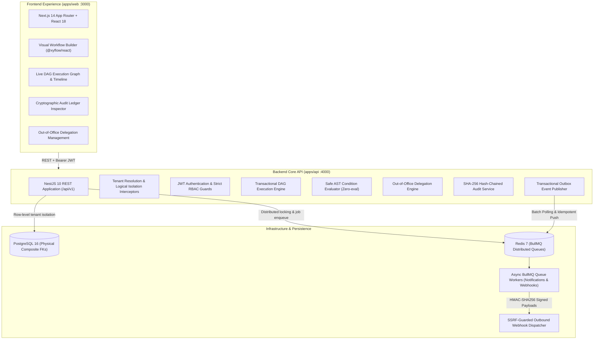
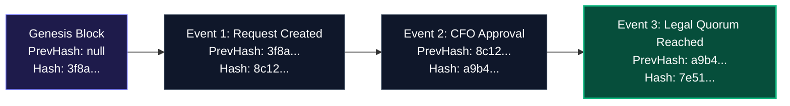

# FlowGate

> **Enterprise Multi-Tenant Approval Workflow Platform & DAG Execution Engine**  
> _Architected for modern enterprises requiring high-assurance approval routing, parallel quorum voting, out-of-office delegation, tamper-evident SHA-256 audit ledgers, and zero-trust tenant isolation._

[](https://github.com/kvijay5/FlowGate/actions)
[](https://www.typescriptlang.org/)
[](https://nestjs.com/)
[](https://nextjs.org/)
[](https://www.prisma.io/)
[](https://tailwindcss.com/)
[](LICENSE)

---

## Executive Overview

**FlowGate** is a production-grade, multi-tenant Software-as-a-Service (SaaS) platform built to automate, orchestrate, audit, and accelerate multi-step approval workflows across enterprise departments—such as Capital Expenditure (Finance), Legal & Compliance review, Human Resources, and Engineering/DevOps deployment gates.

Unlike basic sequential form-approval tools, FlowGate features a **Transactional Directed Acyclic Graph (DAG) Execution Engine** with parallel branch execution, conditional AST expression evaluation, multi-party quorum policies, selective fast-forward resubmissions, out-of-office delegation authority, and an immutable **SHA-256 cryptographic audit chain** verified at the database level.

---

## System Architecture

FlowGate is structured as a high-velocity TypeScript monorepo managed with `pnpm` workspaces, isolating concerns across frontend, backend REST services, and shared domain contracts.



---

## Core Technical Highlights & Engineering Decisions

### 1. Dynamic DAG Execution Engine & Join Convergence

Workflows in FlowGate are evaluated as dynamic Directed Acyclic Graphs supporting sequential steps, parallel approval forks, conditional branches, and join synchronization:

- **Graph Validation**: Enforces single-component DAG topology, root trigger presence, non-empty terminal end nodes, and cycle detection via Kahn's algorithm before workflows can be activated.
- **Join Synchronization**: Supports `ALL_INCOMING` and `ANY_INCOMING` join policies. An `ALL_INCOMING` join guarantees that every incoming branch is conclusively evaluated (`COMPLETED` or `PRUNED_SKIPPED`) before downstream execution resumes.
- **Branch Pruning**: When a condition node evaluates to false, unselected branches and downstream nodes are deterministically pruned to `PRUNED_SKIPPED` / `SKIPPED`, preventing join deadlocks.

```mermaid
flowchart LR
    Start(["TRIGGER: Capex Request"]) --> Cond{"CONDITION: Amount > $10,000"}

    Cond -->|"True ($145,000)"| Fork["PARALLEL FORK"]
    Cond -.->"False (Pruned)"| FastTrack["Fast-Track Auto Review (SKIPPED)"]

    Fork --> ParApp["PARALLEL APPROVAL<br/>(2-of-3 Quorum: CFO, Legal, Admin)"]
    Fork --> LegalRev["Legal & Export Compliance"]

    ParApp --> Join["JOIN: ALL_INCOMING<br/>(Synchronized Convergence)"]
    LegalRev --> Join
    FastTrack -.-> Join

    Join --> Approved(["END: APPROVED"])

    classDef default fill:#0f172a,stroke:#334155,stroke-width:1px,color:#f8fafc;
    classDef highlight fill:#1e1b4b,stroke:#6366f1,stroke-width:2px,color:#ffffff;
    classDef active fill:#064e3b,stroke:#10b981,stroke-width:2px,color:#ecfdf5;
    classDef pruned stroke-dasharray: 5 5,stroke:#64748b,color:#94a3b8;

    class Start,Approved highlight;
    class ParApp,LegalRev,Join active;
    class FastTrack pruned;
```

### 2. Quorum Policies & Pessimistic Concurrency Control

- **Quorum Mathematics**: Supports `PARALLEL_AND` (unanimous approval required) and `PARALLEL_OR` (k-of-n quorum threshold).
- **Veto Semantics**: Offers configurable `SOFT_REJECTION` (a single rejection tallies as a vote, allowing quorum to still be reached if sufficient approvals remain) and `STRICT_VETO` (any single rejection immediately rejects the step and request).
- **Concurrency Safety**: High-concurrency voting is protected via database-level pessimistic row locking (`SELECT ... FOR UPDATE`) and serializable Prisma transactions. Concurrent votes from multiple approvers are serialized, eliminating race conditions and double-voting.

### 3. Safe AST Condition Evaluator

Workflow conditions are evaluated using an abstract syntax tree (AST) engine:

- **Zero-`eval` Design**: Implemented without dynamic JavaScript code generation (`eval`, `Function`), guaranteeing immunity from code injection vulnerabilities.
- **Recursive AST Support**: Evaluates nested logical operators (`AND`, `OR`, `NOT`) alongside type-safe numeric, string, and boolean comparison operators (`GT`, `GTE`, `LT`, `LTE`, `EQ`, `NEQ`, `IN`, `CONTAINS`, `STARTS_WITH`, `ENDS_WITH`).
- **Input Schema Enforcement**: Validates runtime payloads against predefined field types (`NUMBER`, `STRING`, `BOOLEAN`) and boundary constraints before executing condition routing.

### 4. Cryptographic SHA-256 Tamper-Evident Audit Chain

Every lifecycle event (workflow creation, step sign-off, comment, state transition, and delegation action) is appended to an immutable audit ledger:

- **Blockchain-Style Hash Linking**: Each `AuditLog` entry stores a cryptographic hash computed as:
  $$\text{Hash}_n = \text{SHA256}(\text{TenantId} \parallel \text{EntityType} \parallel \text{EntityId} \parallel \text{Action} \parallel \text{Metadata} \parallel \text{Timestamp} \parallel \text{Hash}_{n-1})$$
- **Tamper Detection**: An integrated verification engine recalculates the hash chain from genesis to head. If any database record or previous hash pointer is altered, the verification algorithm immediately identifies the compromised entry.



### 5. Out-of-Office Approval Delegation Engine

- **Delegation Lifecycle**: Allows approvers to designate colleagues to act on their behalf during specific time windows (`startDate` to `endDate`).
- **Cycle Prevention**: Validates against self-delegations and circular delegation chains ($A \to B \to A$) via graph cycle traversal.
- **Scope Specificity**: Delegations can be scoped universally across all tenant workflows or constrained to individual workflow definitions.
- **Audit Attestation**: When a delegatee votes, the audit log immutably records both the acting delegatee and the delegator on whose authority the action was cast.

### 6. Transactional Outbox Pattern & SSRF Defense

- **Guaranteed Event Publishing**: State changes and outbox events are written atomically within the same PostgreSQL transaction. An asynchronous publisher polls pending events with Redis distributed locking, guaranteeing at-least-once delivery to BullMQ queues.
- **SSRF-Protected Outbound Webhooks**: Every webhook destination URL undergoes strict DNS resolution and IP verification prior to connection. Outbound HTTP requests targeting private IPv4/IPv6 ranges (RFC 1918, link-local, loopback, cloud metadata endpoints `169.254.169.254`) are intercepted and blocked at the socket layer. Payloads are signed with unique HMAC-SHA256 secrets.

---

## Monorepo Directory Structure

```text
flowgate/
├── .github/
│   └── workflows/
│       └── ci.yml                     # Multi-service GitHub Actions CI workflow
├── apps/
│   ├── api/                           # NestJS 10 REST API Application (Port 4000)
│   │   ├── prisma/
│   │   │   ├── migrations/            # Version-controlled forward migrations
│   │   │   ├── schema.prisma          # Multi-tenant Prisma schema with physical constraints
│   │   │   └── seed.ts                # Flagship showcase seed script (Acme & Globex)
│   │   ├── src/
│   │   │   ├── audit/                 # SHA-256 hash chaining & verification service
│   │   │   ├── auth/                  # JWT auth, tenant resolution & RBAC guards
│   │   │   ├── common/                # Tenant-aware query helpers & filters
│   │   │   ├── escalations/           # BullMQ timeout & SLA escalation processor
│   │   │   ├── health/                # Liveness & database connectivity probes
│   │   │   ├── notifications/         # BullMQ async email/notification worker
│   │   │   ├── outbox/                # Transactional outbox event publisher
│   │   │   ├── queues/                # BullMQ queue management & health metrics
│   │   │   ├── requests/              # Request lifecycle & approval action controllers
│   │   │   ├── webhooks/              # Outbound webhooks & SSRF socket protection
│   │   │   └── workflows/             # DAG Engine, AST Evaluator & Delegation Service
│   │   └── test/                      # 11 E2E integration test suites (135 tests)
│   └── web/                           # Next.js 14 App Router Application (Port 3000)
│       ├── src/
│       │   ├── app/                   # Next.js pages: dashboard, requests, builder
│       │   ├── components/
│       │   │   ├── workflow-builder/   # Visual interactive React Flow canvas builder
│       │   │   └── workflow-execution/ # Live DAG viewer, timeline & audit inspector
│       │   └── lib/                   # Typed API client & session storage
│       └── tailwind.config.ts
├── packages/
│   ├── shared-types/                  # Shared TypeScript interfaces, AST & DTO contracts
│   ├── eslint-config/                 # Shared linting configs
│   └── tsconfig/                      # Shared base TypeScript configs
├── docker-compose.yml                 # Local PostgreSQL 16 & Redis 7 services
├── pnpm-workspace.yaml                # Monorepo workspace configuration
├── DEVELOPMENT_LOG.md                 # Chronological development milestone changelog
└── README.md                          # Recruiter-ready portfolio documentation
```

---

## Quickstart & Local Setup Guide

### 1. Prerequisites

- **Node.js**: `v20.x` or `v24.x` (LTS recommended)
- **pnpm**: `v9.x` or `v12.x` (`corepack enable pnpm` or `npm install -g pnpm`)
- **Docker & Docker Compose**: For running PostgreSQL 16 and Redis 7 containers

### 2. Installation & Environment Configuration

Clone the repository and install all monorepo dependencies:

```bash
git clone https://github.com/kvijay5/FlowGate.git
cd FlowGate
pnpm install
```

Copy the example environment configuration to `.env`:

```bash
cp .env.example .env
```

_(Default values in `.env.example` pre-configure PostgreSQL on port 5432, Redis on port 6379, NestJS on port 4000, and Next.js on port 3000)._

### 3. Launch Local Infrastructure

Start PostgreSQL and Redis in the background using Docker Compose:

```bash
pnpm docker:up
```

### 4. Database Migrations & Showcase Seeding

Apply versioned Prisma migrations and seed the database with the rich showcase dataset:

```bash
pnpm db:migrate
pnpm db:seed
```

### 5. Build Shared Types & Run Development Servers

Build the shared contract packages and start both services:

```bash
pnpm build:shared
pnpm dev
```

- **Frontend Dashboard**: [http://localhost:3000](http://localhost:3000)
- **Backend API Health Probe**: [http://localhost:4000/health](http://localhost:4000/health)

---

## 3-Minute Guided Showcase Walkthrough

The seeded database includes pre-configured tenants, users, workflows, and live DAG execution requests for immediate demonstration.

### Demo Credentials (Password: `FlowGatePass123!`)

| Tenant        | Name & Email                        | Role           | Function in Demo                                                    |
| :------------ | :---------------------------------- | :------------- | :------------------------------------------------------------------ |
| **Acme Corp** | Alice Admin (`admin@acme.com`)      | `TENANT_ADMIN` | Tenant administration, workflow authoring, final approval authority |
| **Acme Corp** | Bob Finance (`finance@acme.com`)    | `APPROVER`     | CFO approver with active Out-of-Office delegation                   |
| **Acme Corp** | Linda Legal (`legal@acme.com`)      | `APPROVER`     | Legal counsel & Bob's active delegatee (quorum decider)             |
| **Acme Corp** | Eric Engineer (`engineer@acme.com`) | `REQUESTER`    | Submits capex requests with structured routing parameters           |
| **Globex**    | Greg Admin (`admin@globex.com`)     | `TENANT_ADMIN` | Demonstrates complete multi-tenant physical isolation               |

---

### Step-by-Step Walkthrough Script

#### Step 1: Out-of-Office Delegation & Context Switcher

1. Navigate to [http://localhost:3000](http://localhost:3000).
2. Click **"Acme CFO"** on the 1-click login panel.
3. Observe the top notification banner:  
   `✈️ Out-of-Office Active: Your review and approval authority is currently delegated to Linda Legal until [Date].`
4. Switch to the **Delegations** tab to inspect the active 7-day delegation, its workflow scope, and the early revocation control.

#### Step 2: Live DAG Execution Graph & Quorum Voting

1. Click **"Approval Requests"** in the navigation bar.
2. Click on Demo Request 1: **"Acme Corp Cloud Infrastructure & AI Compute Cluster Expansion"** ($145,000).
3. Click **"Live DAG"** to open `/requests/ae4d4ea3-44bf-405f-b1e6-be53e409ec1b`.
4. Inspect the interactive **Live Execution Graph**:
   - The `TRIGGER` node and `CONDITION` node evaluated `amount > 10000` to `true`.
   - The `Fast-Track` branch is pruned and marked `SKIPPED`.
   - The parallel approval stage is `IN_REVIEW`. 1 of 2 required votes has been cast by Bob Finance.
   - The node shows: `1 / 2 Approvals (Quorum 2 of 3)`.
5. In the top account switcher, switch to **"Delegatee"** (`legal@acme.com`).
6. In the **"Approval Steps & Voting"** tab, sign off with an approval comment as Linda Legal.
7. Return to the **"Live Execution Graph"** tab:
   - Notice the parallel stage instantly advances to `COMPLETED`.
   - Both branches converge at the `JOIN` node (`ALL_INCOMING`).
   - The request automatically resolves to `APPROVED`!

#### Step 3: Cryptographic Audit Ledger Verification

1. Switch to the **"Cryptographic Audit Chain"** tab on the same request page.
2. Observe the continuous SHA-256 hash chain linking every action from submission to delegated sign-off.
3. Click **"Verify Cryptographic Chain"**:
   - The backend recalculates every block's SHA-256 hash from genesis.
   - A green **"Audit Chain Valid: Verified"** badge confirms zero record tampering.

#### Step 4: Interactive Visual Workflow Builder

1. Click **"Workflows"** in the top navigation bar.
2. Click **"Visual Workflow Builder"** or navigate to `/workflows/new/builder`.
3. Drag nodes (`Trigger`, `Condition`, `Parallel Approval`, `Join`, `End`) onto the interactive canvas.
4. Connect edges between handles.
5. Notice real-time graph validation warnings in the validation banner (e.g. cycle detection, missing triggers, unjoined parallel branches).

---

## Verification & Quality Assurance Suite

FlowGate enforces 100% test passing rates, strict type checking, and zero lint warnings across all packages.

```bash
# 1. Type-check all workspaces (0 errors)
pnpm check-types

# 2. Lint all workspaces with ESLint (0 errors, 0 warnings)
pnpm lint

# 3. Verify Prettier formatting
pnpm format:check

# 4. Run backend & frontend unit test suites (232 tests passing)
pnpm test

# 5. Run end-to-end integration & concurrency test suites (135 tests passing)
pnpm test:e2e

# 6. Production build verification
pnpm build
```

**Automated Test Summary:**

- **Backend Unit Tests (`apps/api`)**: 212 passed in 19 test suites.
- **Frontend Unit Tests (`apps/web`)**: 20 passed in 2 test suites.
- **E2E & Concurrency Tests (`apps/api/test`)**: 135 passed in 11 test suites.
- **Total Passing Tests**: **367 passed**, 0 failed.

---

## REST API Reference (`/api/v1`)

| Endpoint                         | Method | Role                      | Description                                                                 |
| :------------------------------- | :----- | :------------------------ | :-------------------------------------------------------------------------- |
| `/api/v1/auth/login`             | `POST` | Public                    | Authenticates tenant user; returns JWT token. Rate-limited.                 |
| `/api/v1/workflows`              | `GET`  | Authenticated             | Lists all workflows belonging to the authenticated tenant.                  |
| `/api/v1/workflows`              | `POST` | `TENANT_ADMIN`, `MANAGER` | Validates and creates a new DAG workflow definition.                        |
| `/api/v1/workflows/:id/publish`  | `POST` | `TENANT_ADMIN`, `MANAGER` | Validates DAG topology and publishes workflow to `ACTIVE`.                  |
| `/api/v1/requests`               | `GET`  | Authenticated             | Queries requests with filter parameters (`pending_approval`, `mine`, etc.). |
| `/api/v1/requests`               | `POST` | Authenticated             | Submits new request with validated `requestData` for condition evaluation.  |
| `/api/v1/requests/:id`           | `GET`  | Authenticated             | Returns request details, step progressions, and node execution states.      |
| `/api/v1/requests/:id/actions`   | `POST` | Approver / Delegatee      | Submits approval, rejection, or changes requested with row-level locking.   |
| `/api/v1/requests/:id/resubmit`  | `POST` | Requester                 | Resubmits request with selective fast-forwarding or full reset.             |
| `/api/v1/delegations`            | `GET`  | Authenticated             | Returns active and historical delegations for the tenant.                   |
| `/api/v1/delegations`            | `POST` | Authenticated             | Authorizes a colleague for out-of-office delegation with date bounds.       |
| `/api/v1/delegations/:id/revoke` | `POST` | Authenticated             | Revokes an active or scheduled delegation.                                  |
| `/api/v1/audit/verify`           | `GET`  | Authenticated             | Recalculates and verifies SHA-256 hash chain integrity for the tenant.      |
| `/api/v1/webhooks`               | `POST` | `TENANT_ADMIN`            | Configures SSRF-protected outbound webhook with HMAC-SHA256 signature.      |

---

## License

This project is licensed under the MIT License — see the [LICENSE](LICENSE) file for details.
